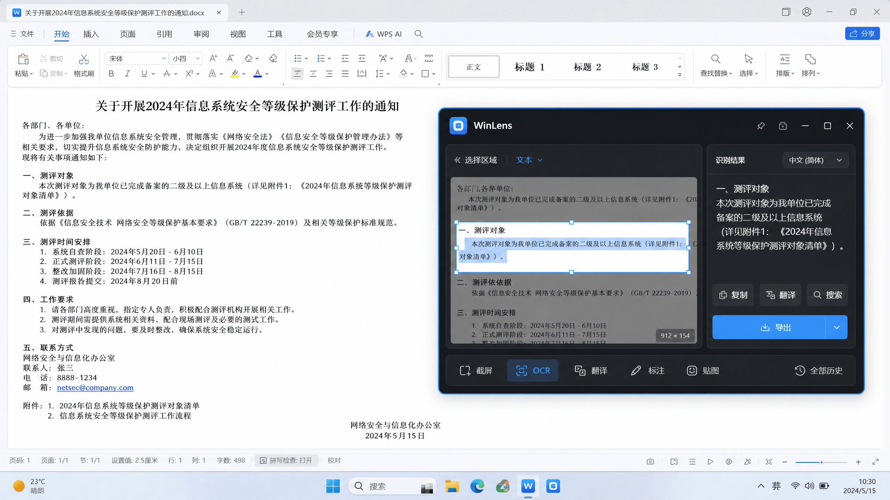
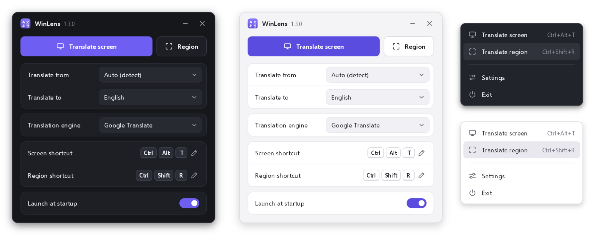

<div align="center">


# WinLens

### Translate any text on your Windows screen, right where it is.

Games, images, PDFs, foreign apps: press a shortcut and the translation appears in place of the original.

<a href="https://github.com/marco-beltrame/WinLens/releases/latest"></a>

[](https://github.com/marco-beltrame/WinLens/releases)
[](https://github.com/marco-beltrame/WinLens/releases)
[](https://github.com/marco-beltrame/WinLens/stargazers)
[](https://github.com/marco-beltrame/WinLens/actions/workflows/build.yml)
[](LICENSE)

**English** · [简体中文](README.zh-CN.md)

<br/>



</div>

<br/>

<table>
<tr>
<td width="33%" valign="top">

**In place**<br/>
The translation covers the original, with the same background and a matching font. No pop-up box.

</td>
<td width="33%" valign="top">

**Any window**<br/>
It reads pixels, not web pages: games, images, PDFs, installers, chats, video subtitles.

</td>
<td width="33%" valign="top">

**No setup**<br/>
Works out of the box with Google Translate. No account, no API key.

</td>
</tr>
<tr>
<td valign="top">

**Whole sentences**<br/>
Lines that wrap are translated as one sentence, then laid back over the same lines.

</td>
<td valign="top">

**Chinese, Japanese, Korean**<br/>
Reads CJK and Latin text on the same screen, and keeps long translations readable.

</td>
<td valign="top">

**Private if you want**<br/>
Use your own LibreTranslate server or a local AI model, and your text stays on your PC.

</td>
</tr>
</table>

## Quick start

1. [Download](https://github.com/marco-beltrame/WinLens/releases/latest) `WinLens.exe` and run it. It lives in the system tray.
2. Pick the language to translate into.
3. Press <kbd>Ctrl</kbd> + <kbd>Alt</kbd> + <kbd>T</kbd> anywhere. Press <kbd>Esc</kbd> to close the translation.

To translate only part of the screen, press <kbd>Ctrl</kbd> + <kbd>Shift</kbd> + <kbd>R</kbd> and drag a rectangle.

## Why WinLens?

Browser translators only work inside web pages. WinLens runs OCR on what is actually on your
screen, so it also translates text you can't select or copy:

- **Text in images:** photos, screenshots, memes, scanned documents.
- **Games:** menus and dialogue, including imported titles.
- **Desktop apps:** installers, error dialogs, foreign software.
- **PDFs and documents** in any reader, **video frames and subtitles**.

If a browser tab can already translate it, you don't need WinLens. For everything else on screen, you do.

## Control panel

A small tray app. The control panel follows the Windows light or dark mode, or the one you pick under **Theme**:
choose the languages and the translation engine, set the shortcuts, and turn on launch at startup.

<div align="center">

</div>

## Shortcuts

| Action | How |
| --- | --- |
| Translate the screen | <kbd>Ctrl</kbd> + <kbd>Alt</kbd> + <kbd>T</kbd>, tray menu, or **Translate screen** |
| Translate a region | <kbd>Ctrl</kbd> + <kbd>Shift</kbd> + <kbd>R</kbd>, tray menu, or **Region**, then drag |
| Close the translation | <kbd>Esc</kbd> or the ✕ button |
| Cancel a slow translation | <kbd>Esc</kbd> while the loading indicator shows |
| See the original | Hold <kbd>Space</kbd> on the overlay |
| Copy the whole translation | <kbd>Ctrl</kbd> + <kbd>C</kbd> on the overlay |
| Copy one block | Right-click it > Copy original / Copy translation |
| Change the target language | The overlay's top bar (re-translates live), or the control panel |
| Change a shortcut | Control panel > click the shortcut, then press your combination |
| Open the control panel | Double-click the tray icon, or tray menu > Settings |

## Translation engines and privacy

Choose the engine under **Translation engine** in the control panel.

| Engine | Setup | Where your text goes |
|---|---|---|
| **Google Translate** (default) | None | Google's servers, with MyMemory as a fallback |
| **LibreTranslate** | The address of a server, plus an API key for hosted ones | That server only |
| **Local AI model** | An OpenAI-compatible server such as [Ollama](https://ollama.com) or [LM Studio](https://lmstudio.ai), e.g. `http://localhost:11434/v1` | Your own PC |

OCR always runs on your PC, and screenshots never leave it. Only the recognized text is sent to
the engine you chose. With LibreTranslate or a local model nothing goes to Google unless you turn
on **Use Google as a backup**. API keys are encrypted for your Windows account (DPAPI).

## Installation

Open the [Releases](https://github.com/marco-beltrame/WinLens/releases) page. Most PCs want
`WinLens.exe`; Snapdragon / ARM devices take the `win-arm64` files.

| Download | Size | Needs a runtime? |
| --- | --- | --- |
| `WinLens.exe` | ~25 MB | Yes, the [.NET 10 Desktop Runtime](https://dotnet.microsoft.com/download/dotnet/10.0) |
| `WinLens-win-x64-standalone.zip` | ~75 MB | No, it is bundled. Extract it and run `WinLens.exe` inside, keeping the files together. |

<details>
<summary><b>"Windows protected your PC"</b></summary>

<br/>

The executable isn't code-signed yet, so SmartScreen may warn you on first launch. Click
**More info > Run anyway**. To verify the download first, compare its checksum with the SHA256
on the release page:

```powershell
Get-FileHash .\WinLens.exe -Algorithm SHA256
```

</details>

<details>
<summary><b>Reading more languages (OCR packs)</b></summary>

<br/>

WinLens uses the Windows OCR engine, so it reads the languages whose OCR pack is installed. Most
systems already have their display language. To add another one, for example Chinese or Japanese:

> Settings > Time & Language > Language & region > (the language) > Language options > Optional features > add the OCR feature.

**Add languages…** at the bottom of the **Translate from** list in the control panel opens that
page. New languages show up automatically.

Leave **Translate from** on Auto: WinLens runs every installed recognizer and keeps what each one
reads well, so a mixed-language screen still works.

</details>

<details>
<summary><b>How it works</b></summary>

<br/>

```
Shortcut > capture > upscale > OCR (per script) > paragraphs > translate > overlay in place
```

1. Capture the monitor under the cursor, or the region you drag (DPI-accurate on mixed-scaling setups).
2. Upscale the image about 2x so small UI text is recognized more reliably.
3. Run every installed OCR recognizer and keep from each only the blocks in its own script, then drop duplicates.
4. Join lines that continue each other into one paragraph. Menus, lists, chat messages and anything doubtful stay separate.
5. Translate the whole screen in one request, cached for the session.
6. Draw a colour- and font-matched box over each original line. A longer translation first uses
   the free space beside the line or a second row, and only then a smaller font.

To translate strictly line by line, as older versions did, set `"GroupParagraphs": false` in
`%AppData%\WinLens\settings.json` and restart WinLens.

</details>

<details>
<summary><b>Building from source</b></summary>

<br/>

```bash
git clone https://github.com/marco-beltrame/WinLens.git
cd WinLens
dotnet build -c Release
dotnet run
```

Requirements: Windows 10 (build 19041 or later) or 11, the
[.NET 10 SDK](https://dotnet.microsoft.com/download/dotnet/10.0) and the Windows Desktop workload (WPF).

| Flag | Effect |
| --- | --- |
| `--settings` | Open the control panel on launch |
| `--translate` | Run one capture-and-translate on launch |

</details>

## Roadmap

- [ ] Offline translation: no network, no rate limits, more privacy.
- [ ] Stronger OCR for CJK and small text, without Windows language packs.
- [ ] macOS and Linux.
- [x] Region capture.
- [x] LibreTranslate and local AI models as translation engines.
- [x] Light and dark mode.

The [issues](https://github.com/marco-beltrame/WinLens/issues) have the full list.

## Contributing

Contributions are welcome: see [CONTRIBUTING.md](CONTRIBUTING.md) and the
[Code of Conduct](CODE_OF_CONDUCT.md). Issues tagged
[good first issue](https://github.com/marco-beltrame/WinLens/issues?q=is%3Aissue+is%3Aopen+label%3A%22good+first+issue%22)
are a good place to start. Found a bug? [Report it](https://github.com/marco-beltrame/WinLens/issues/new?template=bug_report.yml),
or [suggest a feature](https://github.com/marco-beltrame/WinLens/issues/new?template=feature_request.yml).

## License and acknowledgements

MIT, see [LICENSE](LICENSE). Translation through the Google Translate endpoint with a
[MyMemory](https://mymemory.translated.net/) fallback; tray integration with
[Hardcodet.NotifyIcon.Wpf](https://github.com/hardcodet/wpf-notifyicon); built with .NET 10 and WPF.
