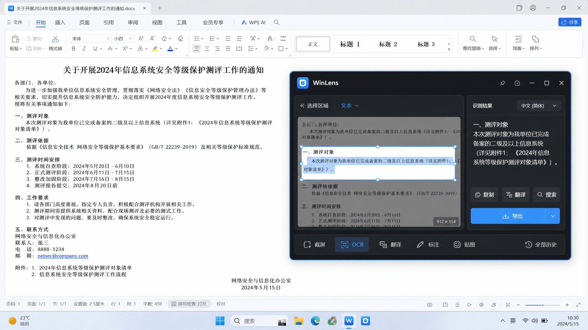
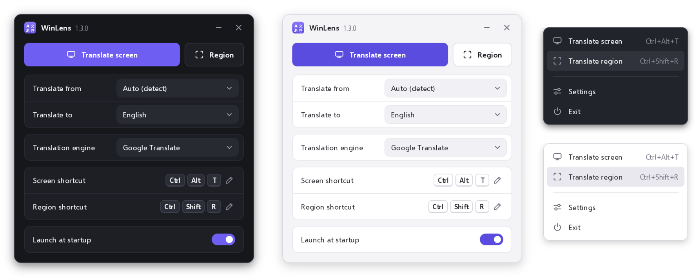

<div align="center">


# WinLens

### 翻译 Windows 屏幕上的任何文字，译文就显示在原位。

游戏、图片、PDF、外语软件：按下快捷键，译文直接覆盖在原文的位置上。

<a href="https://github.com/marco-beltrame/WinLens/releases/latest"></a>

[](https://github.com/marco-beltrame/WinLens/releases)
[](https://github.com/marco-beltrame/WinLens/releases)
[](https://github.com/marco-beltrame/WinLens/stargazers)
[](https://github.com/marco-beltrame/WinLens/actions/workflows/build.yml)
[](LICENSE)

[English](README.md) · **简体中文**

<br/>



</div>

<br/>

<table>
<tr>
<td width="33%" valign="top">

**原位显示**<br/>
译文覆盖在原文上，背景相同、字体匹配，不弹出额外的窗口。

</td>
<td width="33%" valign="top">

**任意窗口**<br/>
读取的是屏幕像素而不是网页：游戏、图片、PDF、安装程序、聊天、视频字幕。

</td>
<td width="33%" valign="top">

**无需设置**<br/>
默认使用 Google 翻译，开箱即用。无需账号，无需 API 密钥。

</td>
</tr>
<tr>
<td valign="top">

**整句翻译**<br/>
跨多行的句子作为一句翻译，再按原来的行排回去。

</td>
<td valign="top">

**中文、日文、韩文**<br/>
同一屏幕上可同时识别 CJK 与拉丁文字，较长的译文也保持清晰可读。

</td>
<td valign="top">

**可完全私密**<br/>
使用你自己的 LibreTranslate 服务器或本地 AI 模型，文字不会离开你的电脑。

</td>
</tr>
</table>

## 快速上手

1. [下载](https://github.com/marco-beltrame/WinLens/releases/latest) `WinLens.exe` 并运行，它会常驻在系统托盘。
2. 选择要翻译成的语言。
3. 在任意位置按 <kbd>Ctrl</kbd> + <kbd>Alt</kbd> + <kbd>T</kbd>，按 <kbd>Esc</kbd> 关闭译文。

只翻译屏幕的一部分：按 <kbd>Ctrl</kbd> + <kbd>Shift</kbd> + <kbd>R</kbd> 并拖出一个矩形。

## 为什么用 WinLens？

浏览器翻译只能处理网页内部的文字。WinLens 对屏幕上真实显示的内容运行 OCR，因此也能翻译无法选中或复制的文字：

- **图片里的文字：** 照片、截图、表情包、扫描文档。
- **游戏：** 菜单和对话，包括各类外语游戏。
- **桌面应用：** 安装程序、报错弹窗、外语软件。
- 任意阅读器中的 **PDF 和文档**，以及 **视频画面和字幕**。

如果浏览器标签页已经能翻译，你就不需要 WinLens。屏幕上的其余一切，你需要它。

## 控制面板

一个小巧的托盘应用。控制面板跟随 Windows 的浅色或深色模式，也可在「主题」（Theme）中固定为浅色或深色：选择语言和翻译引擎、设置快捷键、开启开机自启。

<div align="center">

</div>

## 快捷键

| 操作 | 方式 |
| --- | --- |
| 翻译屏幕 | <kbd>Ctrl</kbd> + <kbd>Alt</kbd> + <kbd>T</kbd>、托盘菜单，或「翻译屏幕」（Translate screen） |
| 翻译选定区域 | <kbd>Ctrl</kbd> + <kbd>Shift</kbd> + <kbd>R</kbd>、托盘菜单，或「区域」（Region），然后拖选 |
| 关闭译文 | <kbd>Esc</kbd> 或 ✕ 按钮 |
| 取消较慢的翻译 | 加载指示出现时按 <kbd>Esc</kbd> |
| 查看原文 | 在覆盖层上按住 <kbd>空格</kbd> |
| 复制全部译文 | 在覆盖层上按 <kbd>Ctrl</kbd> + <kbd>C</kbd> |
| 复制单个文本块 | 右键点击 > 复制原文 / 复制译文 |
| 切换目标语言 | 覆盖层顶栏（实时重新翻译），或控制面板 |
| 修改快捷键 | 控制面板 > 点击该快捷键，然后按下你的组合键 |
| 打开控制面板 | 双击托盘图标，或托盘菜单 > 设置（Settings） |

## 翻译引擎与隐私

在控制面板的「翻译引擎」（Translation engine）中选择。

| 引擎 | 设置 | 文字发送到哪里 |
|---|---|---|
| **Google 翻译**（默认） | 无 | Google 服务器，MyMemory 作为兜底 |
| **LibreTranslate** | 服务器地址，托管服务还需 API 密钥 | 仅该服务器 |
| **本地 AI 模型** | 兼容 OpenAI 接口的服务器，如 [Ollama](https://ollama.com) 或 [LM Studio](https://lmstudio.ai)，例如 `http://localhost:11434/v1` | 你自己的电脑 |

OCR 始终在你的电脑上运行，截图不会离开电脑，只有识别出的文字会发送给你选择的引擎。使用 LibreTranslate 或本地模型时，除非打开「用 Google 作为备用」（Use Google as a backup），否则不会向 Google 发送任何内容。API 密钥会针对你的 Windows 账户加密保存（DPAPI）。

## 安装

打开 [Releases](https://github.com/marco-beltrame/WinLens/releases) 页面。大多数电脑选 `WinLens.exe`，Snapdragon / ARM 设备选 `win-arm64` 文件。

| 下载 | 大小 | 需要运行时？ |
| --- | --- | --- |
| `WinLens.exe` | 约 25 MB | 需要 [.NET 10 桌面运行时](https://dotnet.microsoft.com/download/dotnet/10.0) |
| `WinLens-win-x64-standalone.zip` | 约 75 MB | 不需要，已打包。解压后运行里面的 `WinLens.exe`，文件请放在一起。 |

<details>
<summary><b>「Windows 已保护你的电脑」</b></summary>

<br/>

该程序尚未代码签名，首次运行时 SmartScreen 可能会提示。点击 **更多信息 > 仍要运行**。如需先校验文件，可将其 SHA256 与发布页上的值对比：

```powershell
Get-FileHash .\WinLens.exe -Algorithm SHA256
```

</details>

<details>
<summary><b>识别更多语言（OCR 语言包）</b></summary>

<br/>

WinLens 使用 Windows 自带的 OCR 引擎，只能识别已安装 OCR 语言包的语言。大多数系统已包含显示语言。添加其他语言（例如中文或日文）：

> 设置 > 时间和语言 > 语言和区域 >（该语言）> 语言选项 > 可选功能 > 添加 OCR 功能。

控制面板中「源语言」（Translate from）列表底部的「添加语言…」（Add languages…）会直接打开该页面，新语言会自动出现。

「源语言」请保持 Auto：WinLens 会运行每个已安装的识别引擎并保留各自识别得好的文字，混合语言的屏幕也能正常工作。

</details>

<details>
<summary><b>工作原理</b></summary>

<br/>

```
快捷键 > 截屏 > 放大 > OCR（按文字系统）> 合并段落 > 翻译 > 原位覆盖
```

1. 截取鼠标所在的显示器，或你拖选的区域（多显示器、不同缩放下 DPI 精确）。
2. 将图像放大约 2 倍，让小号界面文字更可靠地被识别。
3. 运行每个已安装的 OCR 引擎，各自只保留本文字系统的文本块，再去除重复项。
4. 把相互衔接的行合并为一个段落。菜单、列表、聊天消息和不确定的内容保持分开。
5. 整屏一次请求翻译，并在本次会话中缓存。
6. 在每行原文上绘制颜色与字体匹配的覆盖框。较长的译文先利用行旁的空白或第二行，最后才缩小字号。

如需像旧版本那样严格逐行翻译，在 `%AppData%\WinLens\settings.json` 中设置 `"GroupParagraphs": false` 并重启 WinLens。

</details>

<details>
<summary><b>从源码构建</b></summary>

<br/>

```bash
git clone https://github.com/marco-beltrame/WinLens.git
cd WinLens
dotnet build -c Release
dotnet run
```

环境要求：Windows 10（build 19041 或更高）或 11、[.NET 10 SDK](https://dotnet.microsoft.com/download/dotnet/10.0)，以及 Windows 桌面工作负载（WPF）。

| 参数 | 作用 |
| --- | --- |
| `--settings` | 启动时打开控制面板 |
| `--translate` | 启动时执行一次截屏并翻译 |

</details>

## 路线图

- [ ] 离线翻译：无需联网、无速率限制、更私密。
- [ ] 更强的 CJK 与小字 OCR，无需 Windows 语言包。
- [ ] macOS 和 Linux。
- [x] 区域截取。
- [x] LibreTranslate 和本地 AI 模型作为翻译引擎。
- [x] 浅色和深色模式。

完整列表见 [issues](https://github.com/marco-beltrame/WinLens/issues)。

## 参与贡献

欢迎贡献：请阅读 [CONTRIBUTING.md](CONTRIBUTING.md) 和 [行为准则](CODE_OF_CONDUCT.md)。带
[good first issue](https://github.com/marco-beltrame/WinLens/issues?q=is%3Aissue+is%3Aopen+label%3A%22good+first+issue%22)
标签的 issue 适合作为起点。发现问题？[反馈 Bug](https://github.com/marco-beltrame/WinLens/issues/new?template=bug_report.yml)，
或[提出功能建议](https://github.com/marco-beltrame/WinLens/issues/new?template=feature_request.yml)。

## 许可证与致谢

MIT，见 [LICENSE](LICENSE)。翻译通过 Google Translate 接口完成，[MyMemory](https://mymemory.translated.net/) 作为兜底；托盘集成使用
[Hardcodet.NotifyIcon.Wpf](https://github.com/hardcodet/wpf-notifyicon)；基于 .NET 10 与 WPF 构建。
